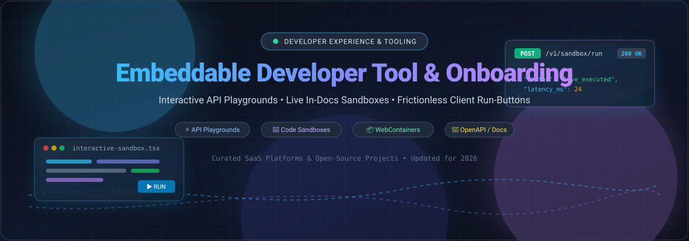

# Awesome Embeddable Developer Tool & Onboarding 🚀

  

  
  
  
  
  
  

---

## 🧭 Overview & Mission

**Curated List of SaaS Platforms & Open-Source GitHub Projects**  
*Focused on In-Docs API Playgrounds, Run-in-Client Buttons, and Embeddable Code Sandboxes*  
📅 **Last updated: March 2026**

This repository tracks notable **SaaS platforms** and **open-source projects** for **Embeddable Developer Tooling & Developer Onboarding**. These tools allow developers to try your REST/GraphQL/gRPC APIs, execute SDK examples, or test live frontend and backend code snippets directly within documentation websites—eliminating the "clone and install first" barrier that causes onboarding drop-off. 

Key paradigms covered include:
- ⚡ **Interactive API Playgrounds & Explorers:** In-docs authentication, live request consoles, pre-filled payloads, and auto-generated code snippets.
- 🚀 **Embeddable Code Sandboxes & WebContainers:** Full Node.js runtimes and frontend micro-sandboxes running client-side inside the browser.
- 🎯 **Run-in-Client Buttons & Collections:** Direct one-click import into native developer tooling workspaces (e.g., Postman collections).
- 📦 **Zero-Build Web Components:** Drop-in custom tags for OpenAPI 3.0 / 3.1 specification rendering.

---

## 📑 Table of Contents
- [📊 Sector Overview & Market Dynamics](#-sector-overview--market-dynamics)
- [☁️ SaaS & Hosted Platforms](#️-saas--hosted-platforms)
- [💻 Open-Source GitHub Projects](#-open-source-github-projects)
- [🛠️ Key Evaluation & Selection Guide](#️-key-evaluation--selection-guide)
- [🤝 How to Contribute](#-how-to-contribute)
- [💖 Support](#-support)
- [📈 Star History](#-star-history)
- [📜 Disclaimer](#-disclaimer)

---

## 📊 Sector Overview & Market Dynamics

The global API documentation and interactive developer tooling market is valued at approximately **$2.8 billion** and projected to surpass **$7.6 billion by 2034** (growing at an 11.7% CAGR), nested inside the broader **$8.8+ billion** API management software ecosystem. 

The market dynamics exhibit **moderate fragmentation**: while legacy API testing and run-button ecosystems demonstrate winner-take-most concentration around enterprise hubs like Postman, modern in-docs playgrounds and browser execution engines remain actively contested between AI-native docs-as-code SaaS entrants (e.g., Mintlify, ReadMe) and high-velocity open-source component frameworks (e.g., Swagger UI, Redoc, Scalar, Sandpack).

---

## ☁️ SaaS & Hosted Platforms

> Sorted in descending order by estimated company valuation / scale.

| Product | Company Scale (Valuation / Revenue) | Description | Pricing (Starting Paid Tier) | Free Forever Tier / Free Trial Limits |
|:---|:---|:---|:---|:---|
| **[Postman Run in Postman](https://learning.postman.com/docs/publishing-your-api/run-in-postman/creating-run-button)** | **$5.6B valuation** (~$300M+ ARR) | Embeddable button that lets developers fork your API collection directly into their Postman workspace. Active buttons auto-update when the source collection changes. Supports HTML and Markdown embeds with JavaScript `_pm()` injection for client-side API keys. | **$12/user/month** (Basic plan, billed annually) | **Free forever plan**: Unlimited collection runs, embeddable button creation, auto-sync, public workspace collaboration up to 3 team members, and 1,000 cloud API calls/month. |
| **[StackBlitz](https://stackblitz.com/)** | **$700M valuation** ($113M+ raised) | Embeddable browser IDE using WebContainers (Node.js running securely inside the client browser). JavaScript SDK supports programmatic `embedProject` and `openProject` with automated package installations and instant cold starts. | **$18/developer/month** (Pro plan, billed annually) | **Free forever plan**: Unlimited public projects, full WebContainers client runtime access, embeddable iframe/SDK editor, and GitHub integration for public repos. |
| **[Mintlify Playground](https://mintlify.com/docs/api-playground/overview)** | **$500M valuation** ($67M raised) | Interactive in-docs API playground. Sends live requests, visualizes authentication states, and auto-generates client code samples across Python, JS, Go, Curl, and Ruby with `x-mint` extension overrides. | **$150/month** (Startup plan) or **$450/month** (Pro plan, billed annually) | **Free forever Hobby plan**: Includes 1 editor, standard documentation hosting, and API reference parsing. Interactive API Playground and custom domains require the **14-day free trial** of the Pro plan. |
| **[ReadMe API Explorer](https://docs.readme.com/)** | **$75M–$100M valuation** ($10M raised) | Hosted developer hub with an in-docs interactive API explorer enabling authenticated API calls directly inside the docs. Includes developer API key personalizations, metrics, and MDX component customization. | **$79/project/month** (Startup plan, billed annually) | **Free forever Starter plan**: Custom domain, standard API reference documentation, and community support for 1 editor. Advanced interactive API Explorer unlocked via **14-day free trial** of Business/Enterprise tier. |
| **[CodeSandbox](https://codesandbox.io/)** | **$50M–$100M valuation** ($15M+ raised) | Embeddable browser sandbox and cloud micro-VM workspaces. Embeddable via iframe and Sandpack integration for live editable code examples, live previews, and package installation directly in docs. | **$15/user/month** (Pro plan, billed annually) | **Free forever plan**: 400 monthly server credits, up to 20 sandboxes per workspace, unlimited public sandboxes, and full embeddable preview support. |
| **[JSFiddle](https://jsfiddle.net/)** | **Bootstrapped** (Independent) | Ultra-lightweight HTML, CSS, and JavaScript playground. Embeddable via script tag or iframe with customizable tab panels (`js,css,html,results`), auto-resize, and dark/light themes. | **€8/month** (Pro monthly) or **€80/year** (~€6.67/month) | **Free forever plan**: Unlimited public fiddles, complete embeddable iframe and script support, full access to external resource CDNs, and zero ads when viewed in embeds. |

---

## 💻 Open-Source GitHub Projects

> Sorted in descending order by GitHub stargazers count. All star badges link directly to the respective repository stargazers page.

| Project | GitHub Stars | Description | Best Suited For |
|:---|:---:|:---|:---|
| **[Swagger UI](https://github.com/swagger-api/swagger-ui)** |  | The industry-standard OpenAPI/Swagger visualizer. Generates interactive documentation with an out-of-the-box browser-executable "Try it out" test console, deep schema definitions, and Streamlit/React wrappers. | Engineering teams needing the most widely recognized and compatible OpenAPI renderer with live testing. |
| **[Redoc](https://github.com/Redocly/redoc)** |  | Extremely clean, responsive three-panel OpenAPI documentation renderer. Distributable as a standalone JS bundle or zero-external-network bundle for strict air-gapped security compliance. | Teams wanting responsive, high-performance, three-panel reference documentation without external tracking. |
| **[Scalar](https://github.com/scalar/scalar)** |  | Modern, interactive API documentation engine with an integrated REST API client. Features offline-first architecture, OpenAPI 3.0/3.1 and Swagger 2.0 support, code snippets in 15+ languages, and drop-in Web Component scripts. | Modern developer portals seeking a modern Stripe-like UI with a powerful built-in request testing client. |
| **[E2B](https://github.com/e2b-dev/E2B)** |  | Open-source secure cloud sandboxing infrastructure for AI apps, code execution, and interactive developer onboarding. Runs untrusted code inside isolated micro-VM sandboxes with sub-second launch times. | Running real, isolated backend code samples (Python, Bash, JS) securely without client browser security risks. |
| **[Sandpack](https://github.com/codesandbox/sandpack)** |  | In-browser live-running component toolkit created by CodeSandbox. Enables zero-backend, embeddable, interactive coding sandboxes for React, Vue, Svelte, and TypeScript directly inside MDX/documentation. | Interactive frontend tutorials, component library docs, and framework onboarding guides. |
| **[Stoplight Elements](https://github.com/stoplightio/elements)** |  | Polished React and Web Component library for OpenAPI 2.0/3.0/3.1 specs. Features a built-in "Try It" request console, multiple layout modes (sidebar and stacked), multi-language code generators, and zero build step embedding. | Production developer hubs needing embeddable, zero-lock-in OpenAPI reference components with live API execution. |
| **[RapiDoc](https://github.com/rapi-doc/RapiDoc)** |  | Custom Web Component that generates interactive API documentation from OpenAPI specs. Ultra-fast, lightweight, dependency-free, and supports extensive theme customization with integrated live API invocation. | Drop-in single-tag HTML deployments that require minimal bundle overhead and comprehensive styling options. |

---

## 🛠️ Key Evaluation & Selection Guide

When deciding between hosted SaaS solutions and open-source embeddable components for developer onboarding, consider these core trade-offs:

1. **Security & Untrusted Code Execution:**
   - Client-only playgrounds (like Swagger UI or Scalar) rely on the visitor's browser for requests, requiring accurate CORS configurations on your target API servers.
   - For executing full-stack SDK code, **StackBlitz WebContainers** runs Node.js client-side in WebAssembly, while **E2B** executes arbitrary code in isolated cloud micro-VMs.

2. **Hosted Convenience vs. Vendor Lock-In:**
   - Hosted platforms (**ReadMe**, **Mintlify**) manage authentication persistence, analytics, and AI assistance out of the box, but carry monthly platform subscription costs.
   - Open-source components (**Stoplight Elements**, **Scalar**, **Redoc**) give you absolute control over styling, domain hosting, and client data privacy at zero software licensing fee.

3. **Time to First Hello-World (TTFHW):**
   - Incorporating a **Postman Run button** or a pre-configured **Sandpack** playground reduces onboarding time from 15+ minutes (installing dependencies locally) down to under 5 seconds.

---

## 🤝 How to Contribute

Contributions are warmly welcomed! Help keep this ecosystem guide comprehensive, accurate, and up to date:

1. 🍴 Fork the repository.
2. 🌿 Create a descriptive feature branch (`git checkout -b add-tool-xyz`).
3. 📝 Update or add your tool in `README.md` adhering to the table format (include pricing tiers, free tier limits, and stargazer links).
4. ✅ Commit your changes (`git commit -m "feat: add ToolXYZ"`).
5. 🚀 Push to your branch and submit a Pull Request.

---

## 💖 Support

Thank you for exploring and supporting this curated resource! If you find this guide helpful for your team, developer documentation, or onboarding initiatives, please consider showing your support:

- ⭐ **Star** this repository on GitHub to help others discover it.
- 🍴 **Fork** and contribute new tools, updates, or benchmarks.
- 📢 **Share** it with your engineering team, DevRel peers, or on social media.
- ☕ **Buy me a coffee**: If you would like to support ongoing curation and maintenance, you can sponsor through the **[GitHub Sponsors Dashboard](https://github.com/sponsors/ishandutta2007)**.

  

---

## 📈 Star History

---

## 📜 Disclaimer

- This repository is a **community-curated** reference list and does not constitute an official endorsement.
- Embeddable API explorers and code execution sandboxes execute network requests or scripts; always ensure appropriate CORS policies, sandbox isolation, and token security before deploying to production.
- All product trademarks, logos, and brand names are property of their respective owners.

---

  <b>Built for Developer Advocates, Technical Writers, API Architects, and DevRel Teams worldwide. 🌐</b>

